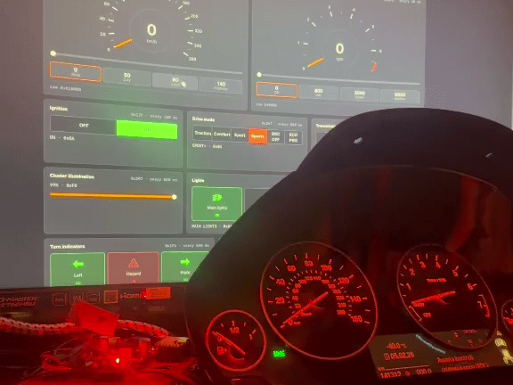

# esp32-automotive-can

This project uses an `ESP32-S3` to connect to a vehicle `CAN BUS`. It is able to scan the existing traffic, as well as to send its own frames. It was built for an `IoT Devices` college course.

It is heavily inspired by the architecture of `.dbc` files.
As a demonstration of it working it can interface with a `BMW F30` gauge cluster.



What doesn't work yet (the fuel and temperature gauges, `OBD II` scanning, other devices) is listed under [Known limitations](docs/architecture.md#known-limitations).

## Documentation

The full documentation is in [`docs/`](docs/):

- **[Full Engineering Report (PDF)](docs/esp32-automotive-can-report.pdf)** - Complete printable documentation
- [Overview](docs/index.md): abstract, objectives, capabilities, hardware, repository structure, authors
- [Setup and usage](docs/setup.md): wiring, Wi-Fi configuration, building and flashing, the web dashboard
- [System architecture](docs/architecture.md): data paths, frame encoding, scheduling, concurrency, modules, known limitations
- [API reference](docs/api.md): REST endpoints, the WebSocket protocol and the C++ firmware API
- [BMW F30 instrument cluster](docs/F30-cluster.md): checksum, rolling counters, update rates, frames the cluster sends
- [BMW F30 CAN IDs](docs/F30-can-ids.md): every message and signal we send
- [DBC files](docs/DBC-overview.md): DBC messages and signals, and how we map them to C++
- [OBD-II](docs/OBD2-overview.md): background on OBD-II modes, frames and PIDs

The docs are built with [MkDocs](https://www.mkdocs.org/) and the [Material](https://squidfunk.github.io/mkdocs-material/) theme. To preview them locally at `http://127.0.0.1:8000/`:

```shell
pip install mkdocs-material
mkdocs serve
```

`mkdocs build --strict` writes the static site to `site/`, which is git-ignored.

## Authors

| Author | GitHub | LinkedIn |
| --- | --- | --- |
| Michał Gagoś | [lizard123137](https://github.com/lizard123137) | [michal-gagos](https://www.linkedin.com/in/michal-gagos/) |
| Kamil Kostka | [KaloeSan](https://github.com/KaloeSan) | [kamilkostka](https://www.linkedin.com/in/kamilkostka/) |

## Sources

A repository that helped us a lot with figuring out how to communicate with the cluster: [CarCluster by r00li](https://github.com/r00li/CarCluster).
