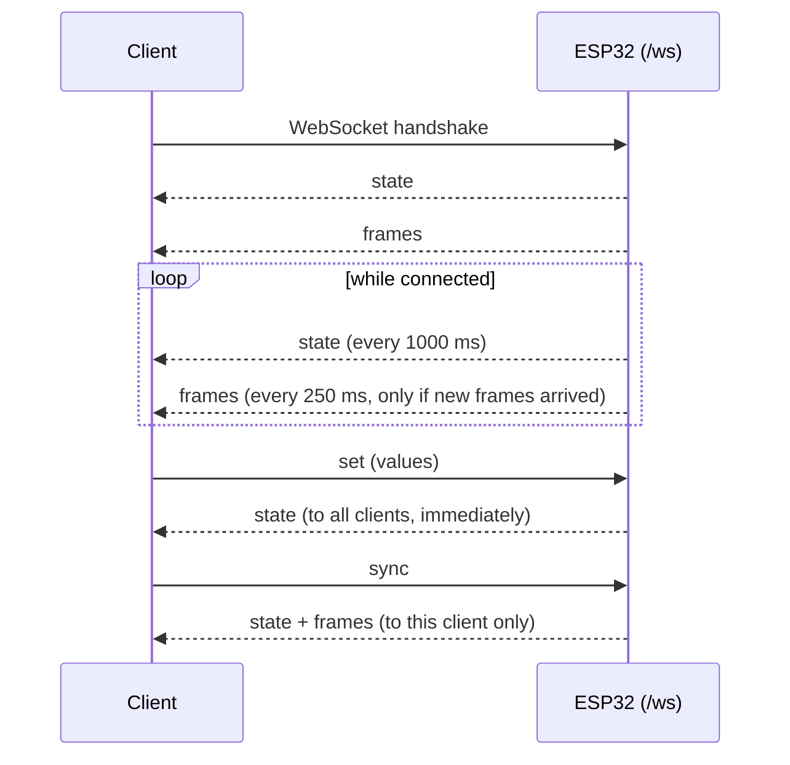

# API Reference

The firmware exposes three interfaces:

| Interface | Transport | Used for |
| --- | --- | --- |
| [HTTP REST API](#http-rest-api) | HTTP/1.1 on port 80 | Serving the dashboard, reading frames and the scheduler, changing one signal |
| [WebSocket protocol](#websocket-protocol) | `ws://<host>/ws` | Live state and frame streaming, batched signal updates |
| [C++ firmware API](#c-firmware-api) | Source code | Defining devices, messages and signals |

All routes are registered in `init_api()` in `src/http/api.cpp`.

## Conventions

- **Signals are addressed by name**, e.g. `speed-value`, `blinker-left` or `ignition-state`. `GET /api/scheduler` lists all names; the [signal reference](F30-can-ids.md#signal-reference) describes the F30 signals.
- **Values are engineering values** (`double`). The firmware converts them to raw bits as described in [Frame encoding](architecture.md#frame-encoding).
- **CAN IDs are JSON numbers in decimal**, e.g. `417` is `0x1A1`.
- **Byte arrays are JSON arrays of numbers 0–255.**
- **No authentication and no CORS headers.** The API is meant for a trusted local network and for the dashboard served from the same origin.

## HTTP REST API

| Method | Path | Description |
| --- | --- | --- |
| `GET` | [`/`](#get) | Web dashboard (HTML) |
| `GET` | [`/api/read`](#get-apiread) | Received CAN frames |
| `GET` | [`/api/scheduler`](#get-apischeduler) | Timers, messages, signals and their current values |
| `PATCH` | [`/api/signals/{name}`](#patch-apisignalsname) | Set one signal value |

Any other path or method returns **404**.

### `GET /`

Returns the dashboard: one self-contained HTML document with inline CSS and JavaScript, stored in flash as the `html` string from `include/http/html.hpp`.

| | |
| --- | --- |
| Response | `200 OK`, `Content-Type: text/html` |

### `GET /api/read`

Returns the most recent received CAN frames, oldest first, at most 100 (`CANManager::MAX_HISTORY_SIZE`). The data comes from a snapshot that `update_api()` refreshes every 250 ms, so it can be up to 250 ms old.

| | |
| --- | --- |
| Parameters | none |
| Response | `200 OK`, `Content-Type: application/json` |

=== "Request"

    ```bash
    curl http://f30.local/api/read
    ```

=== "Response"

    ```json
    {
      "type": "frames",
      "frames": [
        { "id": 435, "dlc": 8, "data": [252, 246, 1, 246, 86, 255, 130, 121] },
        { "id": 709, "dlc": 7, "data": [71, 242, 0, 16, 63, 112, 220] }
      ]
    }
    ```

    These are frames `0x1B3` and `0x2C5`, which the cluster sends itself (see [Packets sent by the cluster](F30-cluster.md#packets-sent-by-the-cluster)).

| Field | Type | Description |
| --- | --- | --- |
| `type` | string | Always `"frames"`. The same document is used as a WebSocket message. |
| `frames[].id` | number | Identifier as reported by `mcp_can`. Bit 31 (`0x80000000`) is set for 29-bit extended frames and bit 30 (`0x40000000`) for remote frames. |
| `frames[].dlc` | number | Data length code (0–8) |
| `frames[].data` | number[] | `dlc` payload bytes |

### `GET /api/scheduler`

Returns the complete active scheduler: every timer with its messages, and every message with its signals and current values. The dashboard uses it to learn which signals exist and how they are encoded.

| | |
| --- | --- |
| Parameters | none |
| Response | `200 OK`, `Content-Type: application/json` |

=== "Request"

    ```bash
    curl http://f30.local/api/scheduler
    ```

=== "Response (first timer only)"

    ```json
    {
      "timers": [
        {
          "interval": 20,
          "messages": [
            {
              "id": 417,
              "name": "Speed",
              "counter": 7,
              "dlc": 4,
              "default_payload": [192, 0, 0, 129, 0, 0, 0, 0],
              "signals": [
                { "name": "speed-value", "start_bit": 8, "bit_length": 24, "factor": 1, "offset": 0, "value": 8454144 }
              ]
            },
            {
              "id": 243,
              "name": "RPM",
              "counter": 7,
              "dlc": 7,
              "default_payload": [96, 0, 192, 240, 0, 255, 255, 0],
              "signals": [
                { "name": "rpm-value", "start_bit": 8, "bit_length": 8, "factor": 1, "offset": 0, "value": 0 },
                { "name": "rpm-calculated-gear", "start_bit": 32, "bit_length": 8, "factor": 1, "offset": 0, "value": 0 }
              ]
            }
          ]
        }
      ]
    }
    ```

    The real response continues with the 100 ms timer (15 messages) and the 500 ms timer (4 messages).

| Field | Type | Description |
| --- | --- | --- |
| `timers[].interval` | number | Timer period in ms |
| `messages[].id` | number | CAN ID (decimal) |
| `messages[].name` | string | Human-readable message name |
| `messages[].counter` | number | Current value of the message's rolling counter, or `-1` if it has none |
| `messages[].dlc` | number | Payload length *before* the CRC byte; with a CRC the bus frame is `dlc + 1` bytes |
| `messages[].default_payload` | number[8] | Template payload; always 8 entries, only the first `dlc` are used |
| `signals[].name` | string | Name used by `PATCH` and the WebSocket |
| `signals[].start_bit`, `bit_length` | number | Bit position within the payload and width |
| `signals[].factor`, `offset` | number | Scaling between value and raw bits |
| `signals[].value` | number | Current engineering value |

### `PATCH /api/signals/{name}`

Sets one signal value. The route is the regular expression `^\/api\/signals\/([\w-]+)$`, which needs the `-DASYNCWEBSERVER_REGEX` build flag, so `{name}` may contain letters, digits, `_` and `-`.

The value is taken from the first of these sources that is present:

| Priority | Source | Example |
| --- | --- | --- |
| 1 | Query parameter `value` | `PATCH /api/signals/ignition-state?value=138` |
| 2 | Form field `value` (`application/x-www-form-urlencoded`) | body `value=138` |
| 3 | JSON object with a numeric `value` | body `{"value": 138}` |
| 4 | Bare JSON number | body `138` |

Text values from the query string or form must parse completely as a finite number. JSON values must be numbers. Bodies larger than 256 bytes are ignored and produce a `400`.

| Status | Body | When |
| --- | --- | --- |
| `200 OK` | `{"status":"success"}` | Value applied. A `state` message is also broadcast to every WebSocket client. |
| `400 Bad Request` | `{"status":"error","message":"Missing or invalid 'value' parameter"}` | No value found, or not a valid number |
| `404 Not Found` | `{"status":"error","message":"Signal not found"}` | No signal with that name in the active scheduler |

=== "Query parameter"

    ```bash
    # Ignition ON (0x8A = 138)
    curl -X PATCH "http://f30.local/api/signals/ignition-state?value=138"
    ```

=== "Form body"

    ```bash
    # Left indicator on
    curl -X PATCH -d "value=1" http://f30.local/api/signals/blinker-left
    ```

=== "JSON body"

    ```bash
    # 50 km/h as encoded by the dashboard: (0x91 << 16) | trunc(50 * 64.01)
    curl -X PATCH -H "Content-Type: application/json" \
         -d '{"value": 9505920}' http://f30.local/api/signals/speed-value
    ```

=== "Responses"

    ```json
    {"status":"success"}
    ```

    ```json
    {"status":"error","message":"Signal not found"}
    ```

## WebSocket protocol

Connect to `ws://<host>/ws`, for example `ws://f30.local/ws`. All messages are JSON text frames.

### Connection lifecycle



### Client to server

| Message | Format | Effect |
| --- | --- | --- |
| Batch update | `{"type":"set","values":{"<name>":<number>, ...}}` | Applies every entry and broadcasts one `state` message |
| Single update | `{"signal":"<name>","value":<number>}` | Handled as a batch of one |
| Resync | `{"type":"sync"}` | The server replies to this client with `state` and `frames` |

```json
{"type":"set","values":{"blinker-left":1,"blinker-right":1}}
```

```json
{"signal":"ignition-state","value":138}
```

```json
{"type":"sync"}
```

Processing rules:

- Only complete, unfragmented **text** frames are processed.
- Malformed JSON is ignored silently.
- Values must be JSON numbers or booleans (`true` is 1, `false` is 0). Strings and other types are skipped.
- Unknown signal names are skipped. The server sends no error and no acknowledgement.
- If at least one value was applied, a `state` message goes to **all** clients, including the sender. Otherwise nothing is sent.
- `type` is only checked for `"sync"`. Any other message with a `values` object, or with `signal`/`value` fields, is treated as an update.

### Server to client: `state`

The device status, all signal values and the current encoded payload of every scheduled message:

```json
{
  "type": "state",
  "can": true,
  "uptime": 734512,
  "heap": 203412,
  "clients": 1,
  "net": { "mode": "STA", "ip": "192.168.18.15", "rssi": -58 },
  "signals": {
    "speed-value": 9505920,
    "rpm-value": 19,
    "rpm-calculated-gear": 0,
    "ignition-state": 138
  },
  "tx": [
    { "id": 417, "crc": true, "data": [197, 128, 12, 145] },
    { "id": 243, "crc": true, "data": [101, 19, 192, 240, 0, 255, 255] }
  ]
}
```

This example is trimmed: the real message lists all 21 signals and has one `tx` entry for each of the 21 messages.

| Field | Type | Description |
| --- | --- | --- |
| `type` | string | `"state"` |
| `can` | boolean | `true` once the MCP2515 has been initialised (`can_ready`) |
| `uptime` | number | Milliseconds since boot (`millis()`) |
| `heap` | number | Free heap in bytes (`ESP.getFreeHeap()`) |
| `clients` | number | Connected WebSocket clients |
| `net.mode` | string | `"STA"` when joined to a Wi-Fi network, otherwise `"AP"` |
| `net.ip` | string | Station IP, or the access-point IP (`192.168.4.1`) in AP mode |
| `net.rssi` | number | Signal strength in dBm; STA mode only |
| `signals` | object | `{ "<name>": value }` for every signal of the active scheduler |
| `tx[].id` | number | CAN ID of a scheduled message, in scheduler order |
| `tx[].crc` | boolean | `true` if `sendMessage()` prepends a CRC byte on the bus |
| `tx[].data` | number[] | The first `dlc` bytes from `getBytes()`: the payload with the counter's current value and *without* the CRC byte |

### Server to client: `frames`

The same document as [`GET /api/read`](#get-apiread): `{"type":"frames","frames":[{"id","dlc","data"}, ...]}`.

### Timing

| Message | Trigger | Recipients |
| --- | --- | --- |
| `state` | Connect, `sync` | Requesting client |
| `state` | Every 1000 ms, and immediately after every accepted change (WebSocket `set` or HTTP `PATCH`) | All clients |
| `frames` | Connect, `sync` | Requesting client |
| `frames` | Every 250 ms if the RX history changed | All clients |

Periodic broadcasts are only sent while at least one client is connected. Once per second the server also calls `cleanupClients()`, which closes the oldest connections beyond the library's client limit.

### Example client

```js
const ws = new WebSocket('ws://f30.local/ws');

ws.onopen = () => {
  // Ignition ON and hazard lights in one batch
  ws.send(JSON.stringify({
    type: 'set',
    values: { 'ignition-state': 0x8A, 'blinker-left': 1, 'blinker-right': 1 },
  }));
};

ws.onmessage = event => {
  const msg = JSON.parse(event.data);
  if (msg.type === 'state') console.log('uptime', msg.uptime, 'speed', msg.signals['speed-value']);
  if (msg.type === 'frames') console.log(msg.frames.length, 'frames buffered');
};
```

### How the dashboard uses the protocol

- **Throttling.** Changes made at the same moment are combined into one `set` message, sent at most every 40 ms.
- **Echo suppression.** For 450 ms after the user changes a signal, incoming `state` values for that signal are ignored, so the control does not jump back while it is being dragged.
- **Reconnect.** If no message arrives for 4 s, the socket is considered dead. Reconnects back off exponentially from 0.5 s to 8 s.
- **HTTP fallback.** While the WebSocket is down, the page polls `GET /api/scheduler` and `GET /api/read` every 1.5 s and sends changes as `PATCH` requests, at most every 120 ms.
- **Tab focus.** When the tab becomes visible again, the page sends `sync`, or reconnects immediately.

## C++ firmware API

How these classes work together at runtime is described in [System Architecture](architecture.md).

### Global objects

Defined in `src/main.cpp`:

```cpp
MCP_CAN CAN(SPI_CS_PIN);          // extern in can.hpp
AsyncWebServer server(80);
AsyncWebSocket ws("/ws");
CANManager can_manager;           // extern in can.hpp
Scheduler current_scheduler;      // extern in scheduler.hpp
```

### `DBCSignal`

`include/dbc/dbc_signal.hpp` describes one bit field of a message, modelled on a `.dbc` `SG_` line (see [DBC files](DBC-overview.md)).

```cpp
struct DBCSignal {
    std::string name;       // API name, e.g. "speed-value"
    uint8_t start_bit;      // first bit, counted LSB-first from payload byte 0
    uint8_t bit_length;     // 1..64
    double factor;          // raw = (value - offset) / factor
    double offset;
    double value;           // current engineering value
    bool is_signed;         // not used by the encoder yet
    bool is_little_endian;  // not used by the encoder yet
};
```

### `DBCMessage`

`include/dbc/dbc_message.hpp` describes one CAN message, modelled on a `.dbc` `BO_` line.

```cpp
class DBCMessage {
public:
    std::string name;
    uint32_t id;                                   // 11-bit standard identifier
    uint8_t dlc;                                   // payload bytes, excluding the CRC byte
    std::array<uint8_t, 8> default_payload{};      // template; signals and counter are written over it
    std::vector<DBCSignal> signals;                // signals are stored by value
    std::function<uint8_t(const uint8_t*, size_t, uint8_t)> crc_func = nullptr;
    uint8_t final_xor = 0;                         // passed to crc_func
    Counter *counter;                              // optional rolling counter
    uint8_t counter_start_bit = 0;

    DBCMessage(std::string name, uint32_t id, uint8_t dlc, Counter *counter = nullptr);

    std::array<uint8_t, 8> getBytes();             // payload with signals and counter applied
    void sendMessage();                            // getBytes() + optional CRC, then CAN.sendMsgBuf(id, 0, len, bytes)
};
```

### `Counter`

`include/counter.hpp` is a wrapping rolling counter.

```cpp
class Counter {
public:
    uint8_t value, min_value, max_value, bit_length, step;

    Counter(uint8_t min_value, uint8_t max_value, size_t bit_length, uint8_t increment = 1);
    void increment();   // value = min + ((value - min + step) % (max - min + 1))
};
```

### `Timer`

`include/timer.hpp` and `src/timer.cpp` group messages that are sent with the same period.

```cpp
class Timer {
public:
    uint64_t interval;                    // ms
    std::vector<DBCMessage*> messages;
    std::vector<Counter*> counters;       // incremented after each transmission round

    Timer(uint64_t interval);
    int run();                            // fires when millis() > last_timestamp + interval; 0 if it fired, 1 if not due
};
```

### `Scheduler`

`include/scheduler.hpp` and `src/scheduler.cpp` hold the set of timers for one device.

```cpp
class Scheduler {
public:
    std::vector<Timer*> timers;

    void step();                                                      // Timer::run() on every timer
    int updateSignalValue(std::string signal_name, double value);    // first match; 0 = updated, -1 = not found
};

extern Scheduler current_scheduler;
```

### `CANFrame` and `CANManager`

`include/can.hpp` is the receive side.

```cpp
#define SPI_CS_PIN 3                // default; may be overridden by secrets.hpp
extern MCP_CAN CAN;

struct CANFrame {
    uint32_t id;                    // mcp_can ID incl. extended (0x80000000) / RTR (0x40000000) flags
    uint8_t dlc;
    std::array<uint8_t, 8> data;
};

class CANManager {
public:
    std::vector<CANFrame> history;                   // oldest first
    static constexpr size_t MAX_HISTORY_SIZE = 100;

    void readFrame();   // if CAN.checkReceive() == CAN_MSGAVAIL: read one frame, append, drop the oldest when full
};

extern CANManager can_manager;
```

### `getCrc8`

`include/crc/crc.hpp` implements the table-driven SAE J1850 CRC-8 described under [Checksum](F30-cluster.md#checksum).

```cpp
inline uint8_t getCrc8(const uint8_t message[], size_t n_bytes, uint8_t final_xor);
// returns crc ^ final_xor
```

### `init_api` and `update_api`

`include/http/api.hpp`:

```cpp
void init_api(AsyncWebServer& server, AsyncWebSocket& ws);  // register routes and /ws, then server.begin()
void update_api(bool can_ready);                            // call from loop()
```

`update_api()` stores `can_ready` in an atomic flag. It refreshes the frame snapshot and publishes `frames` and `state` as listed under [Timing](#timing).

### Device profiles

`include/devices.hpp`:

```cpp
Scheduler& init_scheduler_f30_cluster(void);   // BMW F30 instrument cluster (src/devices/f30_cluster.cpp)
Scheduler& init_scheduler_a4b7_radio(void);    // Audi A4 B7 radio – stub, no messages yet
```

`setup()` selects the device with `current_scheduler = init_scheduler_f30_cluster();`.

### `Logger`

`include/logger.hpp`:

```cpp
enum logger_level { ERROR, INFO, DEBUG };
Logger::print(INFO, "CAN", "Initialized CAN");   // printf-style; messages above current_level (INFO) are dropped
```

### Adding a new device

Contributions are welcome: open a pull request with the features you want added, and implementations for new devices are especially welcome. To add a device, create a file named after it in `src/devices/`, declare its factory in `include/devices.hpp`, and build its `Scheduler` there. `f30_cluster.cpp` is a complete working example.

The example below adds a hypothetical 4-byte message `0x123`; it is **not** a real F30 message. It has one scaled temperature signal, the shared 4-bit counter and a CRC, and is sent every 100 ms. The code goes into `src/devices/f30_cluster.cpp`, next to the existing definitions:

```cpp title="src/devices/f30_cluster.cpp"
// 1. Message: 4 payload bytes + 1 CRC byte = 5-byte frame on the bus
static DBCMessage dbc_message_example("Example Status", 0x123, 4);

// 2. Signal: payload byte 1, 0.5 °C per bit, offset -40 °C
//    25.0 °C -> raw = (25.0 - (-40.0)) / 0.5 = 130 = 0x82
static DBCSignal dbc_sig_example_temp = {
    .name = "example-temp",     // the name used by PATCH and the WebSocket
    .start_bit = 8,
    .bit_length = 8,
    .factor = 0.5,
    .offset = -40.0,
    .value = 25.0,
};

Scheduler& init_scheduler_f30_cluster() {
    // ... existing configuration ...

    // 3. Payload template, counter and checksum
    dbc_message_example.default_payload = { 0xF0, 0x00, 0xFF, 0xFF };
    dbc_message_example.counter = &counter_4bit;   // low nibble of payload byte 0
    dbc_message_example.crc_func = getCrc8;        // CRC becomes byte 0 on the bus
    dbc_message_example.final_xor = 0x00;          // real BMW IDs need their own constant

    // 4. Attach the signal and schedule the message
    dbc_message_example.signals.push_back(dbc_sig_example_temp);
    timer_mid.messages.push_back(&dbc_message_example);   // every 100 ms

    // ... timers are added to the scheduler as before ...
    return scheduler_f30_cluster;
}
```

After flashing, the message appears in the dashboard's **Transmitted** table, and the signal can be controlled straight away without changing `api.cpp`:

```bash
curl -X PATCH "http://f30.local/api/signals/example-temp?value=90"
```

Rules:

- With a CRC, `dlc` must be **7 or less**, because the CRC byte takes one of the 8 bytes of a classic CAN frame.
- `push_back()` **copies** the signal. Runtime updates change the copy inside `message.signals`, not the static `DBCSignal` object.
- Signal names must be **unique**, because `updateSignalValue()` updates the first match. Use only letters, digits, `_` and `-`, so that the `PATCH` route matches the name.
- A counter only advances if it is registered with a timer (`timer.counters`); see [Counter sharing](architecture.md#scheduling-and-timing).
