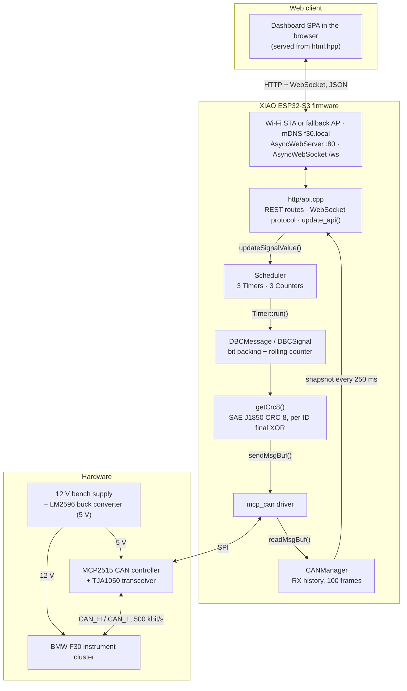
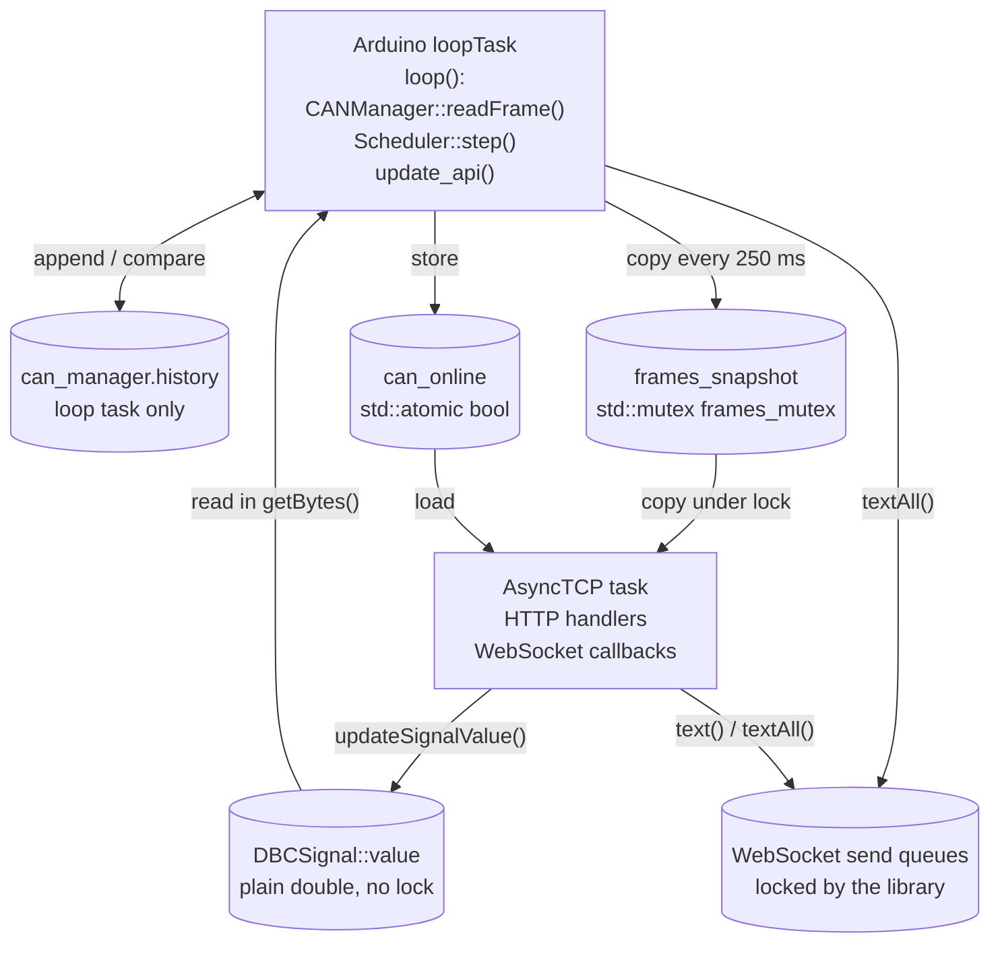

# System Architecture

The firmware is organised around a small, `.dbc`-inspired model:

- A **`Scheduler`** owns several **`Timer`** objects.
- Each timer periodically transmits a list of **`DBCMessage`** objects.
- Each message is a default payload plus bit-packed **`DBCSignal`** fields, optionally with a rolling **`Counter`** and a CRC-8 checksum.

Clients only ever change *signal values*. The scheduler re-encodes and re-sends the frames on its own.

## Technology stack

| Layer | Technology |
| --- | --- |
| Build system | PlatformIO, `espressif32` platform, Arduino framework, C++17 (`-std=gnu++17`) |
| CAN driver | `coryjfowler/mcp_can` |
| Web server | `esp32async/ESPAsyncWebServer` + `esp32async/AsyncTCP` (regex routes enabled with `-DASYNCWEBSERVER_REGEX`) |
| JSON | `bblanchon/ArduinoJson` v7 |
| Front end | Vanilla HTML, CSS and JavaScript embedded in flash (`PROGMEM`), with no CDN or external assets |
| Documentation | MkDocs with the Material theme |

## System block diagram



The buck converter also supplies 5 V to the XIAO itself; see [Power](setup.md#power).

## Data paths

### Transmit path (browser to cluster)

1. **Handler.** A WebSocket `set` message or a `PATCH /api/signals/{name}` request (see the [API reference](api.md#websocket-protocol)) is handled in `src/http/api.cpp` on the AsyncTCP task. The handler calls `Scheduler::updateSignalValue(name, value)` for every entry and immediately broadcasts a fresh `state` message.
2. **Scheduler.** `updateSignalValue()` walks timers, then messages, then signals, and overwrites the `value` of the first signal with that name. Nothing is transmitted at this point.
3. **Timer.** `loop()` calls `Scheduler::step()`, which calls `Timer::run()` on each timer. When a timer's interval has elapsed, it calls `DBCMessage::sendMessage()` for each of its messages and then increments its counters.
4. **Bit packing.** `DBCMessage::getBytes()` starts from `default_payload`, writes each signal's raw value, then the message's rolling counter (see [Frame encoding](#frame-encoding)).
5. **Checksum.** If `crc_func` is set, `sendMessage()` computes `getCrc8(payload, dlc, final_xor)`, shifts the payload right by one byte and puts the CRC in byte 0. The frame length becomes `dlc + 1`.
6. **SPI to CAN.** `CAN.sendMsgBuf(id, 0, len, bytes)` (from `mcp_can`) loads an MCP2515 transmit buffer over SPI. The MCP2515 arbitrates and transmits the standard 11-bit frame at 500 kbit/s through the TJA1050 transceiver.

### Receive path (bus to browser)

1. **MCP2515.** It receives every frame on the bus; `MCP_ANY` disables acceptance filtering.
2. **`CANManager::readFrame()`.** Called once per `loop()` iteration. It polls `CAN.checkReceive()`, reads one frame with `CAN.readMsgBuf()` and appends it to `can_manager.history`. When the history holds 100 frames, the oldest is erased first.
3. **Snapshot.** Every 250 ms `update_api()` compares `history` with `frames_snapshot`. If they differ, it copies `history` into the snapshot while holding `frames_mutex`.
4. **Publishing.** The snapshot is served as the WebSocket `frames` message and by `GET /api/read`.

!!! note "A controller never receives its own frames"
    The MCP2515 does not receive the frames it transmits, so the dashboard's **Received** table shows only traffic from other nodes. On the bench, that is the [frames the cluster sends](F30-cluster.md#packets-sent-by-the-cluster).

## Frame encoding

`DBCMessage::getBytes()` implements the encoding part of a `.dbc` signal definition:

```text
raw = (uint64_t)((value - offset) / factor)        // truncated, unsigned
bit i of raw  ->  payload bit (start_bit + i)      // i = 0 .. bit_length-1
payload bit n ->  byte n / 8, bit n % 8            // little-endian (Intel) bit order
```

- Bits beyond `dlc` are dropped, as are signals with `bit_length` 0 or above 64.
- The counter is written the same way at `counter_start_bit`, which is 0 for every F30 message, i.e. the low bits of payload byte 0.
- The CRC is computed over the first `dlc` payload bytes *after* the counter has been inserted.
- `sendMessage()` then prepends the CRC. All bit positions in the firmware therefore refer to the **payload**: for a message with a CRC, payload byte *n* is byte *n + 1* on the bus.

### Worked example: speed `0x1A1`

The dashboard encodes 50 km/h as `speed-value = (0x91 << 16) | trunc(50 × 64.01) = 0x910C80` (9505920). The [signal reference](F30-can-ids.md#signal-reference) explains this encoding.

| Step | Bytes (hex) |
| --- | --- |
| `default_payload` (dlc 4) | `C0 00 00 81` |
| after `speed-value` (start bit 8, 24 bits) | `C0 80 0C 91` |
| after counter (4 bits at bit 0, value 0) | `C0 80 0C 91` |
| CRC = `getCrc8(payload, 4, 0xA9)` | `EF` |
| **Frame on the bus** (DLC 5) | **`EF C0 80 0C 91`** |

On the next cycle the counter is 1, so byte 1 becomes `C1` and the CRC changes accordingly.

## Scheduling and timing

`src/devices/f30_cluster.cpp` builds one `Scheduler` with three timers:

| Timer | Interval | Messages | Counters it increments |
| --- | --- | --- | --- |
| `timer_fast` | 20 ms | 2 | `counter_4bit` |
| `timer_mid` | 100 ms | 15 | `counter_alive`, `counter_acc` |
| `timer_slow` | 500 ms | 4 | – |

The timer of each message is the *Period* column of the [implemented messages](F30-can-ids.md#implemented-messages) table. The counters are defined under [Rolling counter](F30-cluster.md#rolling-counter).

**Counter sharing.** A counter advances only when the timer it is registered with (`Timer::counters`) fires. Messages on other timers sample its current value. For example, `counter_4bit` advances every 20 ms, while ignition (100 ms) and drive mode (500 ms) read whatever value it has when they are sent.

**Timing accuracy.** `Timer::run()` fires when `millis() > last_timestamp + interval`, so the real period is `interval + 1` ms plus the time until `loop()` gets back to the timer. `loop()` never blocks: CAN reads are non-blocking and the web server runs on its own task.

**Bus load.** About 250 frames/s. That is roughly 25–30 kbit/s including bit stuffing, or about 5–6 % of the 500 kbit/s bus.

## Concurrency and synchronization

Two FreeRTOS tasks share state:

- **Arduino `loopTask`** (core 1 by default) runs `loop()`: CAN reception, the scheduler (all transmissions) and `update_api()` (periodic publishing).
- **AsyncTCP task** (`async_tcp`) runs every HTTP request handler and WebSocket event callback registered in `init_api()`.



| Shared data | Writer | Readers | Protection |
| --- | --- | --- | --- |
| `can_manager.history` | `loopTask` (`readFrame`) | `loopTask` (`update_api`) | None needed: only the loop task touches it |
| `frames_snapshot` | `loopTask` (`update_api`) | AsyncTCP (`frames_json()`) | `std::mutex frames_mutex`. Readers copy the vector under the lock and serialise it after releasing it. |
| `can_online` | `loopTask` (`update_api`) | AsyncTCP (`state_json()`) | `std::atomic<bool>` |
| `DBCSignal::value` | AsyncTCP (`updateSignalValue`) | `loopTask` (`getBytes`), AsyncTCP (`state_json`) | None; see [Known limitations](#known-limitations) |
| WebSocket send queues | Both tasks (`textAll`, `text`) | AsyncTCP | Internal locking in ESPAsyncWebServer / AsyncTCP |

JSON parsing and serialisation run on the AsyncTCP task. `loop()` copies the RX history at most four times per second instead of locking it for every received frame. Both keep expensive work away from the timing-sensitive loop.

## Module responsibilities

| Module | Files | Responsibility |
| --- | --- | --- |
| **Application entry** | `src/main.cpp` | Defines the global objects (`CAN`, `server`, `ws`, `can_manager`, `current_scheduler`). `setup()` brings up the network ([details](setup.md#network-behaviour-at-boot)), initialises the MCP2515 without blocking, starts the API and loads the F30 scheduler. `loop()` reads CAN, steps the scheduler, retries CAN init every 5 s while it is down, and calls `update_api()`. |
| **CAN I/O** | `include/can.hpp` | Header-only; there is no `can.cpp`. Holds the default `SPI_CS_PIN`, `extern MCP_CAN CAN`, `CANFrame`, and `CANManager` with its 100-frame RX history. |
| **DBC model** | `include/dbc/dbc_signal.hpp`, `include/dbc/dbc_message.hpp` | `DBCSignal` and `DBCMessage`. `getBytes()` encodes the payload; `sendMessage()` adds the CRC and transmits. |
| **Checksum** | `include/crc/crc.hpp` | 256-entry lookup table and `getCrc8()` (algorithm under [Checksum](F30-cluster.md#checksum)) |
| **Scheduling** | `include/counter.hpp`, `include/timer.hpp`, `src/timer.cpp`, `include/scheduler.hpp`, `src/scheduler.cpp` | `Counter`: a wrapping counter with configurable range and step. `Timer`: sends its messages and increments its counters. `Scheduler`: steps all timers and looks signals up by name. |
| **Device profiles** | `include/devices.hpp`, `src/devices/f30_cluster.cpp`, `src/devices/a4b7_radio.cpp` | Factory functions that build a configured `Scheduler`: the [BMW F30 cluster](F30-can-ids.md) and the Audi A4 B7 radio (stub) |
| **Web API** | `include/http/api.hpp`, `src/http/api.cpp` | `init_api()` registers the HTTP routes and `/ws`; `update_api()` publishes from `loop()`. See the [API reference](api.md). |
| **Web dashboard** | `include/http/html.hpp` | The single-page app as one `PROGMEM` string: encodes controls into signal values, runs the WebSocket client with HTTP fallback, and renders the telemetry and CAN monitor |
| **Logging** | `include/logger.hpp` | `Logger::print(level, module, fmt, ...)` with `ERROR`, `INFO` and `DEBUG` levels; the active level is `INFO` |
| **OBD-II** | `include/obd2.hpp` | Functional request ID and PID constants ([OBD-II](OBD2-overview.md)) |
| **Configuration** | `include/secrets.hpp` (git-ignored), `include/secrets.example.hpp`, `platformio.ini` | Wi-Fi credentials and the CS pin; board, build flags and libraries |

## Design decisions

- **Declarative device profiles.** A device is data (timers, messages, signals), not code. A new device needs one factory function, and the web API discovers its signals automatically through the scheduler.
- **Values, not frames, cross the API boundary.** Clients set engineering values by signal name, while counters, CRCs and timing always come from the firmware. A client can therefore never send a frame with an invalid checksum or break the cluster's expected cadence.
- **Non-blocking start-up.** A missing or mis-wired MCP2515 must not prevent debugging over Wi-Fi. CAN initialisation is retried in the background, and every CAN call is skipped while `can_ready` is false. Without a responding controller, SPI reads return garbage, such as DLC values up to 15.
- **Embedded, dependency-free UI.** The dashboard is compiled into flash. It works on the isolated fallback access point, with no internet access and no filesystem image to upload.
- **Immediate feedback.** Every accepted change triggers a `state` broadcast with the re-encoded payloads. The transmit table in every open browser shows the new bytes within milliseconds, not at the next 1 s status tick.

## Known limitations

- **Fuel and temperature gauges.** The fuel mapping is empirical and may depend on the cluster's market variant (see [Fuel level](F30-can-ids.md#fuel-level)). The temperature gauge does not yet show values correctly.
- **OBD-II.** It is not implemented; only protocol background and PID constants exist (see [OBD-II](OBD2-overview.md)).
- **Other devices.** Only the F30 profile is implemented. The Audi A4 B7 radio profile is an empty stub.
- **Receiving.** `loop()` polls the MCP2515. The interrupt pin is not used and no hardware acceptance filters are configured.
- **Logging.** `Logger::print` formats messages, but its `Serial.printf` call is commented out, so nothing is printed.
- **Signal encoding.** Signals are packed as unsigned, little-endian (Intel) bit fields only. The `is_signed` and `is_little_endian` fields of `DBCSignal` are not used yet.
- **Unsynchronised signal values.** The AsyncTCP task writes signal values (plain `double` fields) and the loop task reads them without a lock. The scheduler's structure never changes after `setup()`, only the values do, so at worst one frame carries a value that is one update out of date. A torn read of an 8-byte `double` is theoretically possible on the 32-bit Xtensa core but has no practical effect here. A production design would add a lock or use an atomic raw integer.

## Resource usage

Build of the current `main` for `seeed_xiao_esp32s3`:

| Resource | Used | Available | Share |
| --- | --- | --- | --- |
| RAM (static) | 56,396 B | 327,680 B | 17.2 % |
| Flash (application) | 1,693,346 B | 3,342,336 B | 50.7 % |
