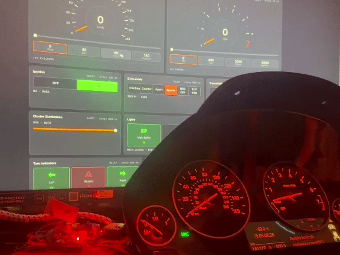

# ESP32 Automotive CAN & BMW F30 Cluster Controller

*Engineering report for the IoT Devices university course, by [Michał Gagoś and Kamil Kostka](#authors).*

## Abstract

Cars pass data between their electronic control units (ECUs) over a CAN bus. For this project we built a cheap, Wi-Fi-connected CAN interface from an ESP32-S3 microcontroller and an MCP2515 CAN controller.

It does two things at once:

- It logs all traffic on the bus.
- It acts as a set of simulated ECUs that send periodic frames.

The frames are not hard-coded byte arrays. Each one is described as a message made of signals, the same model `.dbc` files use. The firmware can add optional rolling counters and checksums the receiver might expect.

A web dashboard served by the ESP32, plus a REST and WebSocket API, lets you change any signal while the system is running. We tested it on a BMW F30 (3 Series) instrument cluster on a bench. There we are using simulated CAN frames to drive the gauges, indicators and warning lights with no car attached.

## Objectives

- Describe a device as timers, messages and signals instead of hard-coded byte arrays.
- Let the firmware take care of transmission timing, bit packing, rolling counters and checksums.
- Monitor and control the bus over Wi-Fi, in real time, from any browser.
- Show that the approach works on real automotive hardware.

## Capabilities

| Capability | Description | Implementation |
| --- | --- | --- |
| CAN traffic scanner | Receives every frame on the bus, with no acceptance filters. Keeps the last 100 and streams them to the browser and the REST API. | `CANManager` (`include/can.hpp`) |
| DBC-based ECU simulator | Sends 21 BMW F30 messages on three timers (20, 100 and 500 ms), with DBC-style signals, rolling counters and SAE J1850 CRC-8 checksums. | `Scheduler`, `Timer`, `DBCMessage`, `DBCSignal` |
| Web dashboard | Single-page app stored in flash. Controls every signal over a WebSocket and falls back to HTTP if the WebSocket drops. | `include/http/html.hpp` |
| REST and WebSocket API | Reads received frames and the scheduler, and sets any signal by name. | `src/http/api.cpp` |
| Networking | Joins your Wi-Fi as `http://f30.local/` (mDNS). If that fails, it opens its own access point. | `src/main.cpp` |
| Boots without CAN | The web UI comes up even if the MCP2515 does not respond. CAN init is retried every 5 s. | `src/main.cpp` |

On the F30 cluster, the dashboard controls:

- the speedometer and rev counter;
- ignition, drive modes and the gear display;
- lights, turn indicators and illumination;
- check-control alerts and the parking brake;
- the fuel and temperature gauges and the steering wheel buttons.

The firmware also sends "OK" status messages for ABS, power steering, airbag, seatbelt and TPMS (tyre pressure monitoring), so those warning lights stay off. [BMW F30 CAN IDs](F30-can-ids.md) has the full list of messages and signals.

## Live demo



## Hardware summary

| Qty | Component | Role |
| --- | --- | --- |
| 1 | Seeed Studio XIAO ESP32-S3 | Wi-Fi, web server, scheduler, SPI host |
| 1 | MCP2515 CAN module | SPI-to-CAN |
| 1 | BMW F30 instrument cluster | Device under test |
| 1 | 12 V bench power supply | Powers the cluster |
| 1 | LM2596 step-down converter, set to 5 V | Powers the XIAO and the CAN module |
| - | Connector harness, jumper wires, USB-C cable | Wiring and programming |

The wiring diagram, pinouts and power-up steps are in [Setup and usage](setup.md#1-hardware-wiring).

## Repository structure

```text
esp32-automotive-can/
├── platformio.ini              # Board, build flags, library dependencies
├── mkdocs.yml                  # This documentation site
├── docs/                       # Documentation sources and images
├── include/
│   ├── can.hpp                 # CANFrame, CANManager (RX history), SPI_CS_PIN
│   ├── counter.hpp             # Counter (rolling counters)
│   ├── crc/crc.hpp             # getCrc8(): SAE J1850 CRC-8
│   ├── dbc/dbc_message.hpp     # DBCMessage: bit packing, counter, CRC, send
│   ├── dbc/dbc_signal.hpp      # DBCSignal
│   ├── timer.hpp               # Timer: periodic group of messages
│   ├── scheduler.hpp           # Scheduler: set of timers, signal lookup
│   ├── devices.hpp             # Device profile factory prototypes
│   ├── http/api.hpp            # init_api(), update_api()
│   ├── http/html.hpp           # Web dashboard (PROGMEM string)
│   ├── logger.hpp              # Logger
│   ├── obd2.hpp                # OBD-II PID constants
│   └── secrets.example.hpp     # Template for Wi-Fi credentials and CS pin
└── src/
    ├── main.cpp                # setup()/loop(): Wi-Fi, mDNS, CAN init, API, scheduler
    ├── scheduler.cpp
    ├── timer.cpp
    ├── http/api.cpp            # REST endpoints and WebSocket protocol
    └── devices/
        ├── f30_cluster.cpp     # BMW F30 cluster profile
        └── a4b7_radio.cpp      # Audi A4 B7 radio profile (stub)
```

## Authors

| Author | GitHub | LinkedIn |
| --- | --- | --- |
| Michał Gagoś | [:fontawesome-brands-github: lizard123137](https://github.com/lizard123137) | [:fontawesome-brands-linkedin: michal-gagos](https://www.linkedin.com/in/michal-gagos/) |
| Kamil Kostka | [:fontawesome-brands-github: KaloeSan](https://github.com/KaloeSan) | [:fontawesome-brands-linkedin: kamilkostka](https://www.linkedin.com/in/kamilkostka/) |

## Credits

- [CarCluster by r00li](https://github.com/r00li/CarCluster) helped us a lot with figuring out how to talk to the cluster.
- The [openinverter.org wiki](https://openinverter.org/wiki/BMW_F-Series_Gear_Lever) documents the messages of the F-series gear selector (GWS).
- [node-bmw-ref by kmalinich](https://github.com/kmalinich/node-bmw-ref) is a reference for BMW CAN IDs.

The project is released under the GNU General Public License v3.0.
