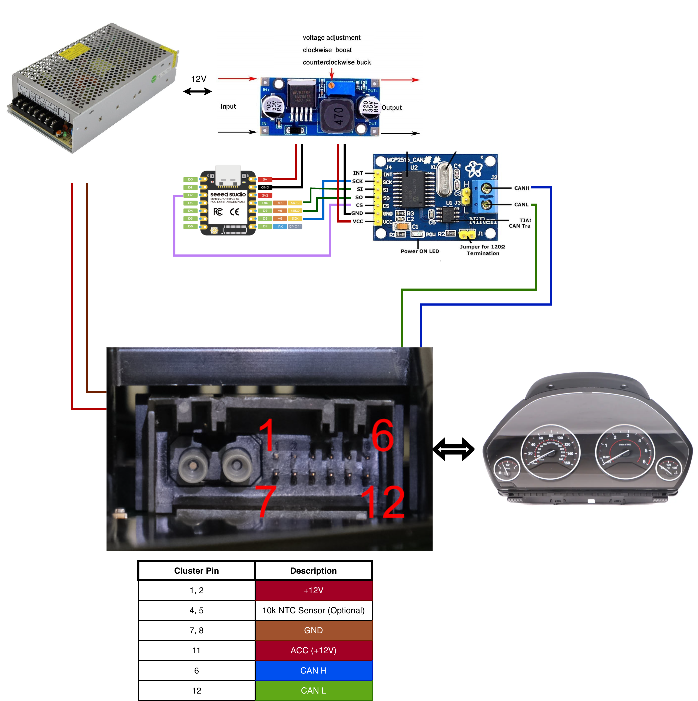

# Setup and usage

This guide covers wiring, firmware configuration, flashing, the web dashboard, and building this documentation.

## 1. Hardware wiring



### Power

| From | To |
| --- | --- |
| 12 V supply `+V` / `-V` | Cluster supply and ground pins (see [Cluster connector](#cluster-connector)) and buck converter `IN+` / `IN-` |
| Buck converter `OUT+` (5 V) | XIAO `5V` pin and MCP2515 module `VCC` |
| Buck converter `OUT-` | XIAO `GND` and MCP2515 module `GND` |

!!! danger "Set the buck converter to 5 V before connecting the electronics"
    The LM2596 module is adjustable and can output almost its full input voltage. Power it from the 12 V supply with nothing connected to its output. Then turn the trimmer while measuring `OUT+`/`OUT-` with a multimeter until it reads 5.0 V. Clockwise raises the voltage and counter-clockwise lowers it, as marked on the schematic. Only then connect the XIAO and the CAN module.

!!! important "Common ground"
    The power supply, the buck converter, the XIAO, the MCP2515 module and the cluster must all share one ground. CAN is a differential bus, but the transceiver still needs a common reference with the cluster.

### XIAO ESP32-S3 to MCP2515 module (SPI)

The MCP2515 uses the board's default SPI pins. The firmware selects the chip with `SPI_CS_PIN`.

| MCP2515 module pin | XIAO ESP32-S3 pin | ESP32-S3 GPIO | Notes |
| --- | --- | --- | --- |
| `VCC` | `5V` (buck output) | - | The module's TJA1050 transceiver needs 5 V |
| `GND` | `GND` | - | |
| `SCK` | `D8` | GPIO7 | SPI clock |
| `SI` | `D10` | GPIO9 | MOSI |
| `SO` | `D9` | GPIO8 | MISO |
| `CS` | `D2` | GPIO3 | Must match `SPI_CS_PIN`, see below |
| `INT` | not connected | - | The firmware polls the MCP2515 |

!!! warning "The chip-select pin must match `SPI_CS_PIN`"
    `include/can.hpp` defines `SPI_CS_PIN` as 3 (GPIO3 = `D2`), which matches the schematic. `include/secrets.example.hpp` redefines it as 5 (GPIO5 = `D4`). `src/main.cpp` includes `secrets.hpp` after `can.hpp`, so the value in your `secrets.hpp` wins, and the compiler warns that `SPI_CS_PIN` is redefined.

    Make the value match your wiring: use `3` (or delete the line) for CS on `D2`, or keep `5` and wire CS to `D4`. If they don't match, the dashboard shows **MCP2515 Offline**.

!!! note "5 V module and 3.3 V GPIO"
    On the common blue MCP2515 module, the MCP2515 and the TJA1050 both run from `VCC`, so the `SO` (MISO) output swings to 5 V. ESP32-S3 GPIOs are 3.3 V and are not specified as 5 V tolerant. It worked on our bench, but a resistor divider or a level shifter on `SO` is the safer choice for anything beyond a lab demo.

### Cluster connector

| Cluster pin | Function | Connect to |
| --- | --- | --- |
| 1, 2 | +12 V (permanent supply) | 12 V supply `+V` |
| 4, 5 | 10 kΩ NTC temperature sensor (optional) | not connected |
| 6 | CAN H | MCP2515 module `CANH` |
| 7, 8 | GND | 12 V supply `-V` (common ground) |
| 11 | ACC (+12 V) | 12 V supply `+V` |
| 12 | CAN L | MCP2515 module `CANL` |

Use a short twisted pair for `CAN_H`/`CAN_L`.

### 120 Ω termination

A CAN bus needs a 120 Ω terminator at each end, which gives 60 Ω between `CAN_H` and `CAN_L`. The MCP2515 module's terminator is enabled with the J1 jumper. Fit it, because on the bench the module is one end of the bus.

To check the termination, switch everything off and measure the resistance between `CAN_H` and `CAN_L`:

| Reading | Meaning |
| --- | --- |
| about 60 Ω | Both ends terminated (ideal) |
| about 120 Ω | One terminator, usually fine for a short bench harness |
| open circuit | No termination. Fit J1, otherwise frames will not be acknowledged. |

### Crystal and bit rate

The firmware expects an 8 MHz crystal on the MCP2515 module and a 500 kbit/s bus. `MCP_ANY` turns off the acceptance filters:

```cpp title="src/main.cpp"
static bool init_can() {
    // IMPORTANT! Some older vehicles use 250kbps.
    if (CAN.begin(MCP_ANY, CAN_500KBPS, MCP_8MHZ) != CAN_OK) {
        return false;
    }
    CAN.setMode(MCP_NORMAL);
    return true;
}
```

Check the marking on the module's crystal. `8.000` matches the code. If it says `16.000`, change `MCP_8MHZ` to `MCP_16MHZ`.

With the wrong setting, the MCP2515 still initialises and the dashboard shows **MCP2515 Active**. However, every bit is timed at half or double the real rate, so the cluster ignores all frames.

## 2. Firmware configuration

### Wi-Fi credentials and CS pin

We keep credentials out of version control. Copy the template and fill it in:

```bash
cp include/secrets.example.hpp include/secrets.hpp
```

```cpp title="include/secrets.example.hpp"
#pragma once
// Copy this file to include/secrets.hpp (git-ignored) and fill in your own values.
#define WIFI_SSID "Your_WiFi_SSID"
#define WIFI_PASS "Your_WiFi_Password"
#define SPI_CS_PIN 5
```

`include/secrets.hpp` is listed in `.gitignore`. Set `SPI_CS_PIN` to match your [wiring](#xiao-esp32-s3-to-mcp2515-module-spi).

### Network behaviour at boot

`setup()` in `src/main.cpp` goes through these steps:

1. It starts station (STA) mode with hostname `f30`, calls `WiFi.begin(WIFI_SSID, WIFI_PASS)` and waits up to 8 s.
2. If that works, it starts the mDNS responder as `f30` and advertises an `http` service on TCP port 80. The dashboard is then at `http://f30.local/`.
3. If it fails, it stops the station's reconnect attempts, switches to AP+STA mode and opens an access point with SSID `BMW_F30_Cluster` and password `12345678`. The dashboard is then at `http://192.168.4.1/`.
4. It initialises the MCP2515, with up to 3 attempts 500 ms apart, then starts the web server and loads the F30 scheduler. If CAN is still down, `loop()` retries every 5 s and the web UI keeps working.

!!! warning
    The fallback access point password is hard-coded in `src/main.cpp` and public in the repository. Change it before using the device outside a lab.

### Build and upload

Install [PlatformIO](https://platformio.org/), either as the VS Code extension or the CLI. The libraries listed in `platformio.ini` (see [Technology stack](architecture.md#technology-stack)) are downloaded on the first build.

```bash
pio run                      # build
```

```bash
pio run --target upload      # flash over USB-C
```

```bash
pio device monitor -b 9600   # serial monitor (optional)
```

In VS Code you can use the **Upload and Monitor** button in the PlatformIO tab instead.

!!! tip
    If the upload does not start, hold the XIAO's **BOOT** button while plugging in the USB cable, then upload again.

!!! note "Serial output"
    `Serial` runs at 9600 baud, but `Logger` output is disabled (see [Known limitations](architecture.md#known-limitations)), so the monitor only shows boot ROM messages. Use the dashboard's telemetry drawer to check the device's state instead.

## 3. Using the web dashboard

Open the dashboard from a device on the same network:

- `http://f30.local/` through mDNS. This works on Windows 10+, macOS, iOS and Linux with Avahi; some Android versions do not resolve `.local` names.
- `http://<device-ip>/`, using the IP address your router assigned.
- `http://192.168.4.1/` when connected to the `BMW_F30_Cluster` fallback access point.

The page loads nothing from the internet.

### Bench bring-up

1. Switch on the 12 V supply. The ESP32 boots from the buck converter, and the cluster is powered through pins 1, 2 and 11.
2. Open the dashboard. The header badges should read **Connected** and **MCP2515 Active**.
3. Set **Ignition** to **ON**. The firmware starts with the ignition off, so the cluster stays dark until you switch it on.
4. Move the speed and RPM dials and toggle the lights and indicators. Each change takes effect the next time the affected message is sent, at most 500 ms later.

### Dashboard cards

| Card | Signals | Controls |
| --- | --- | --- |
| Speed | `speed-value` | Draggable dial, slider 0-260 km/h, presets 0 / 50 / 90 / 140 |
| RPM | `rpm-value`, `rpm-calculated-gear` | Draggable dial, slider 0-6900 rpm, presets 0 / 800 / 3000 / 6500; red zone from 6500 rpm |
| Ignition | `ignition-state` | OFF / ON. Both dials dim while the ignition is off. |
| Drive mode | `drive-mode-state` | Traction, Comfort, Sport, Sport+, DSC OFF, ECO PRO |
| Transmission | `gear-automatic`, `rpm-calculated-gear` | P, R, N, D. From D, the M/S button enables the - and + buttons for gears 1-9. |
| Cluster illumination | `backlight-brightness` | Slider 0-253, shown as a percentage and a hex value |
| Lights | `main-lights`, `high-beam`, `front-fog`, `rear-fog` | Toggle tiles. The status line shows the active lamps and their bits, e.g. `HIGH BEAM · 0x02`. |
| Turn indicators | `blinker-left`, `blinker-right` | Left and right cancel each other, hazard sets both, e.g. `HAZARD · 0x30` |
| Alerts | `alert-type`, `alert-value` | One of 28 predefined check-control messages or a raw hex type byte, switched ON or OFF |
| Parking brake | `handbrake` | Engaged / released |
| Fuel level | `fuel-level-1`, `fuel-level-2` | Slider 0-100 % |
| Engine and oil temperature | `oil-temp`, `engine-temp` | Slider 100-200 °C, sets both signals |
| Steering wheel buttons | `steering-wheel-buttons` | Raw button byte, entered as hex |

The raw values behind each control are listed in the [signal reference](F30-can-ids.md#signal-reference).

### Telemetry & CAN monitor

The drawer at the bottom of the page can be opened and closed. It shows:

| Item | Shows |
| --- | --- |
| Summary line | CAN status, IP address, free heap and uptime |
| Link | WebSocket, HTTP fallback, Connecting, or Offline with a retry countdown |
| Frames received | Frames currently buffered on the ESP32 (up to 100) |
| Frames sent | Transmit rate, estimated from the scheduler's timer periods |
| Clients | Connected WebSocket clients |
| Transmitted table | Every scheduled message with its live payload. `CRC +` marks messages that get a CRC byte on the bus, and a payload cell flashes when one of the message's signals changes. |
| Received table | The last frames read from the bus, newest first, with a **Pause** button |

All open browsers stay in sync. Reconnecting and the HTTP fallback are described in [How the dashboard uses the protocol](api.md#how-the-dashboard-uses-the-protocol).

### Troubleshooting

| Symptom | What to check |
| --- | --- |
| Badge shows **MCP2515 Offline** | SPI wiring, the `SPI_CS_PIN` value, 5 V at the module's `VCC` |
| **MCP2515 Active**, but the cluster does not react | Ignition ON, the crystal setting (8 vs 16 MHz), `CAN_H`/`CAN_L` swapped, termination, 12 V on cluster pins 1, 2 and 11 |
| **Received** table stays empty | Expected while only the ESP32 is sending ([why](architecture.md#receive-path-bus-to-browser)). It fills up once the cluster is awake. |
| `f30.local` does not open | The client doesn't support mDNS. Use the IP address, or check whether the device fell back to its access point. |
| Link badge shows **HTTP fallback** | The WebSocket is blocked (for example by a proxy). The page keeps working over HTTP. |

## 4. Building this documentation

The documentation uses [MkDocs](https://www.mkdocs.org/) with the [Material](https://squidfunk.github.io/mkdocs-material/) theme:

```bash
pip install mkdocs-material
```

```bash
mkdocs serve           # live preview at http://127.0.0.1:8000/
```

```bash
mkdocs build --strict  # static site in site/; fails on any warning, including broken links and anchors
```

The Mermaid diagrams are drawn in the browser by the Material theme, so they need an internet connection the first time they load.
